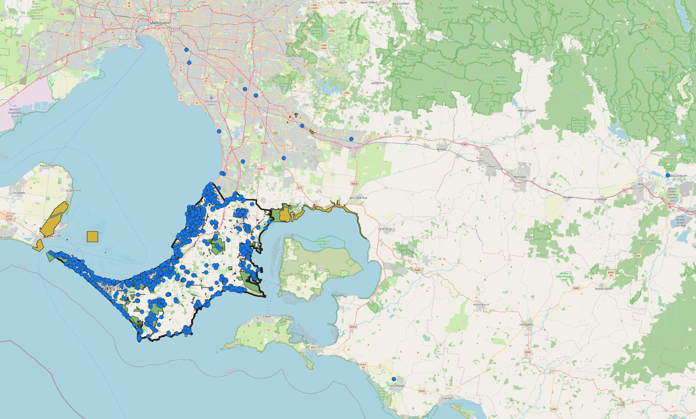
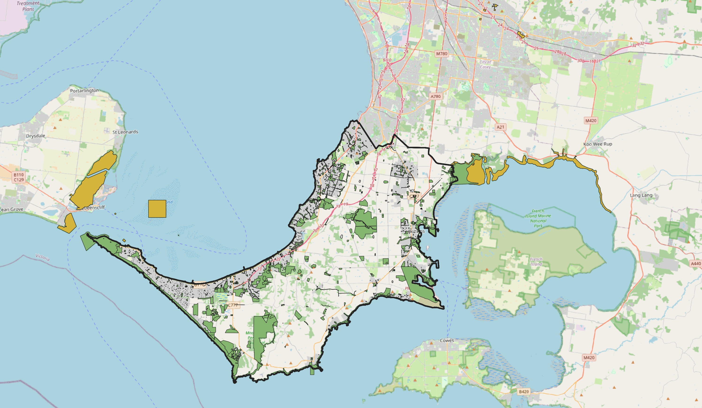
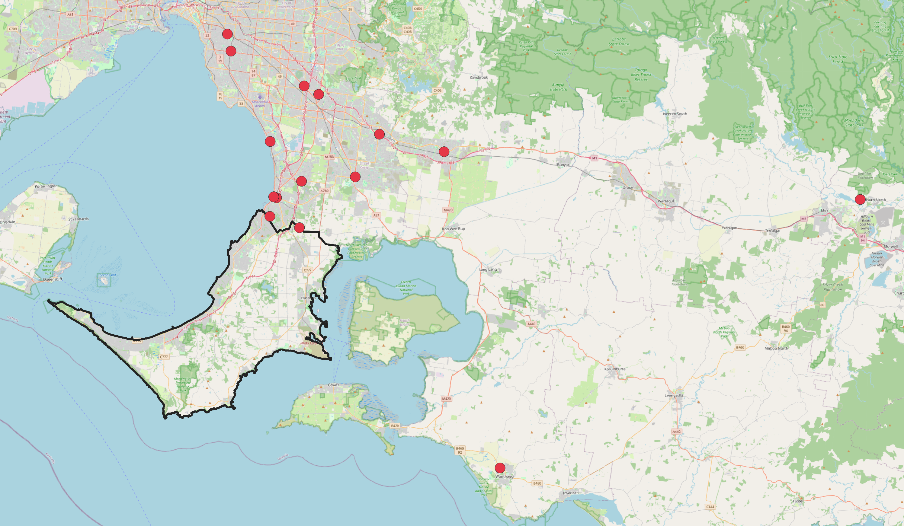

# Vicmap Features of Interest (FOI) – Data Quality Control, Mornington Peninsula

A QGIS-based quality control (QC) review of the Vicmap Features of Interest dataset for the Mornington Peninsula LGA. The project checks geometry, spatial extent, duplicate locations and attribute completeness, and documents each finding with the tool used, the result and a short interpretation.

*Red: FOI_POINT. Green: FOI_POLYGON inside the boundary. Yellow: FOI_POLYGON parts outside the boundary (Finding 1).*

## Objective

To practise a repeatable QC workflow on an authoritative state spatial dataset: define a check, run it with a standard QGIS tool, inspect the result, and decide whether it is a data error or a valid characteristic of the data.

## Data Sources

- **Vicmap Features of Interest** (FOI_POINT: 1,321 features, which hold 1,347 individual points because the layer is multipoint; FOI_POLYGON: 2,646 features), downloaded as Shapefile (MGA2020 Zone 55) for the Mornington Peninsula LGA via DataShare, Victorian Government.
- **EXTRACT_POLYGON**, the boundary layer supplied with the data, used as the reference extent. It is a single polygon (the downloaded file contained 10 rows with identical geometry, reduced to one with Delete duplicate geometries). It is referred to below as "the boundary".
- All layers analysed in **EPSG:7855** (GDA2020 / MGA zone 55).

> **Licence and attribution:** Vicmap Features of Interest © State of Victoria (Department of Transport and Planning), obtained from DataShare (Order 4PDR1L, 13 Oct 2026; dataset published 9 Oct 2026), licensed under [Creative Commons Attribution 4.0 International (CC BY 4.0)](https://creativecommons.org/licenses/by/4.0/). The data was processed in QGIS for quality-control analysis (for example, duplicate boundary geometries were reduced to one); the original data is not redistributed in this repository. Dataset information: https://www.land.vic.gov.au/maps-and-spatial/spatial-data/vicmap-catalogue/vicmap-features-of-interest

## Tools

QGIS: Extract by location, Multipart to singleparts, Check validity (GEOS), Delete duplicate geometries, Select by expression, Add geometry attributes, Statistics.

## Summary of Findings

| # | Check | Layer | Result |
|---|-------|-------|--------|
| 1 | Features outside the boundary (EXTRACT_POLYGON) | FOI_POLYGON | 0 on the original layer; 22 parts of 4 multipart reserve features fall outside after splitting to singleparts. |
| 2 | Geometry validity | FOI_POLYGON | 2,646 valid, 0 invalid |
| 3 | Co-located points | FOI_POINT | 22 extra features share a geometry with another feature (27 involved, 1,299 unique geometries); none are true duplicates |
| 4 | Missing NAME | Both | Points: 135 of 1,321 features (10.2%). Polygons: 1,622 of 2,646 (61.3%) |
| 5 | Size outliers among unnamed parks | FOI_POLYGON | 57 parks over 10,000 m²; 11 polygons under 10 m² (probable artefacts) |
| 6 | Points outside the boundary | FOI_POINT | 0 features lie entirely outside, but 16 of 1,347 points (from 5 multipoint education-centre features) do |

## Findings in Detail

### Finding 1: Parts of reserve features fall outside the boundary

- **Check:** Extract by location (disjoint) against EXTRACT_POLYGON.
- **Result:** 0 features on the original layer. After Multipart to singleparts, 22 parts lie outside the boundary. They belong to 4 multipart features and all have FTYPE = reserve (national parks, conservation reserves, parks).
- **Interpretation:** The boundary most likely excludes marine areas, and these reserves extend into water. This is probably a boundary-definition effect rather than a data error. The same check on FOI_POINT returns 0 features outside the boundary, but this does not rule out single points inside multipoint features (see Finding 6).

*Green: FOI_POLYGON features inside the boundary. Yellow: the 22 reserve parts that fall outside it. Black outline: EXTRACT_POLYGON.*

### Finding 2: Polygon geometry validity

- **Check:** Check validity (GEOS) on FOI_POLYGON.
- **Result:** Valid 2,646 / Invalid 0 / Error 0.

### Finding 3: Co-located point features

- **Check:** Delete duplicate geometries on FOI_POINT (this compares whole geometries, so it works at feature level).
- **Result:** 22 extra features share a geometry with another feature (27 features involved), leaving 1,299 unique geometries. All 27 have distinct UFI, PFI and FEATURE_ID values, so none are true duplicates.
- **Interpretation:** Most are broadcast TV/radio transmitters (FTYPE = communication) on a shared tower, plus a few co-located services. These are valid features, but any analysis that counts points by location should account for them.

### Finding 4: Missing NAME values

- **Check:** Select by expression: `"NAME" IS NULL OR trim("NAME") = ''`.
- **Result:**
  - FOI_POINT: 135 of 1,321 features (10.2%) have no NAME.
  - FOI_POLYGON: 1,622 of 2,646 (61.3%) have no NAME. Of these, 1,338 (50.6% of the layer) also have no PARENTNAME.
  - Of these 1,338: reserve 1,194 (89.2%), sport facility 70, education centre 54, storage facility 7, excavation site 7, hospital 4, power facility 1, commercial facility 1.
  - Reserves with no NAME and no PARENTNAME: 1,194 of 1,919 (62.2%), all with FEATSUBTYP = park.
  - Area of these 1,194 parks (m², EPSG:7855): median 396, Q1 146, Q3 1,023, min 2, max 810,719 (about 81 ha).
- **Interpretation:** Missing names are concentrated in small parks (75% under about 1,000 m²), which likely have no official name, so this is mostly a completeness limitation rather than a systematic error. NAME cannot be used to identify or count parks reliably; FTYPE/FEATSUBTYP should be used instead.

### Finding 5: Size outliers among unnamed parks

- **Check:** Select by expression on the area field of the 1,194 unnamed parks, sorted by area.
- **Large:** 57 of 1,194 (4.8%) are over 10,000 m²; 16 (1.3%) are over 100,000 m² (10 ha). The largest are about 81 ha, 73 ha and 42 ha.
- **Tiny:** 11 of 1,194 (0.9%) are under 10 m² (about 2 to 6.5 m²). One polygon (6.5 m², perimeter 65.6 m) inspected at 1:65 is a strip about 0.2 m × 33 m, i.e. a sliver. Five others have near-identical area (about 5.5 m²) and perimeter (about 37 m).
- **Large-park inspection:** All 16 parks over 10 ha were checked for child features: only 3 have CHILDEXIST = Y, so a missing NAME is not explained by the parks simply containing named child features. One park of about 20 ha was inspected in detail: FTYPE = reserve, FEATSUBTYP = park, NAME and PARENTNAME both NULL.
- **Interpretation:** The tiny polygons are probably digitising or overlay artefacts and should be excluded or reviewed before any area-based analysis. The 16 unnamed parks over 10 ha are the most worthwhile unnamed records to review first; they have not all been individually verified on the map.

### Finding 6: Multipoint features with points outside the boundary

- **Check:** Multipart to singleparts on FOI_POINT (1,321 features → 1,347 points), then Extract by location (disjoint) against EXTRACT_POLYGON.
- **Result:** 16 of 1,347 points lie outside the boundary. They belong to 5 multipoint features, all FTYPE = education centre: Chisholm Institute of TAFE (5 points), Oakwood School (7), Woodleigh School (2), Somers School Camp (1) and Flinders Christian Community College (1).
- **Interpretation:** These are most likely institutions with several sites stored as one multipoint feature. The data seems to have been selected by feature, so a feature with at least one point inside the LGA is kept with all of its points. This is probably a boundary-definition effect, not a data error. Three points were checked on the map: one of Chisholm Institute of TAFE lies in the south-eastern suburbs, another of Chisholm Institute of TAFE lies near Wonthaggi, and the one of Somers School Camp lies far to the east near Yallourn North in the Latrobe Valley. The other 13 points were not individually verified. Counts of points by location should use singleparts and be clipped to the boundary.

*Red: the 16 points outside EXTRACT_POLYGON (black outline). Basemap © OpenStreetMap contributors.*

## Limitations

- Findings are based on attribute and geometry checks only; no field verification or comparison with an independent dataset was done.
- FOI_POINT is a multipoint layer, so feature counts (1,321) and point counts (1,347) differ. Findings 3 and 4 are reported per feature.
- Only three of the 16 points outside the boundary (Finding 6) were checked on the map; the others were not individually verified.
- Explanations (marine boundary, shared towers, small unnamed parks, multi-site institutions) are interpretations of the patterns, not confirmed causes.
- Only the Mornington Peninsula LGA was reviewed.

## Possible Next Steps

- Review the 16 large unnamed parks individually against aerial imagery.
- Check the 16 points outside the boundary against the institutions' published site addresses.
- Automate the checks with the Graphical Modeler so they can be re-run on new data releases.
- Repeat the checks for another LGA to compare results.

## Files

- `QC_findings.txt`: full QC log
- `Vicmap_FOI_Quality_Control_Mornington.qgz`: QGIS project
- `images/`: map screenshots
